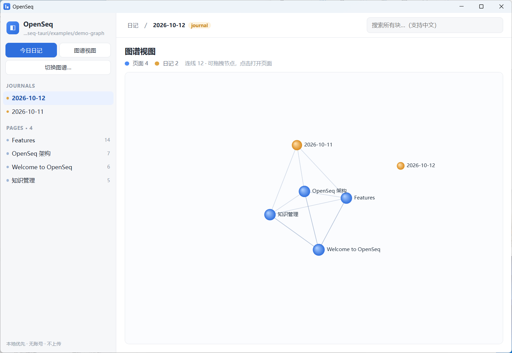
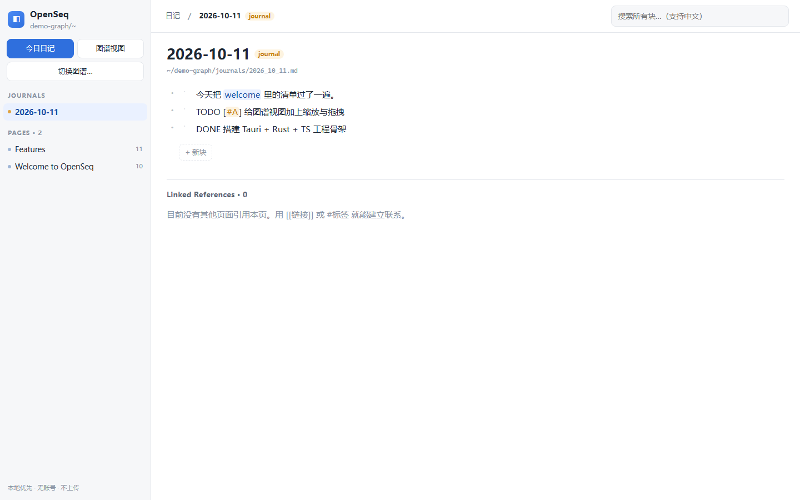
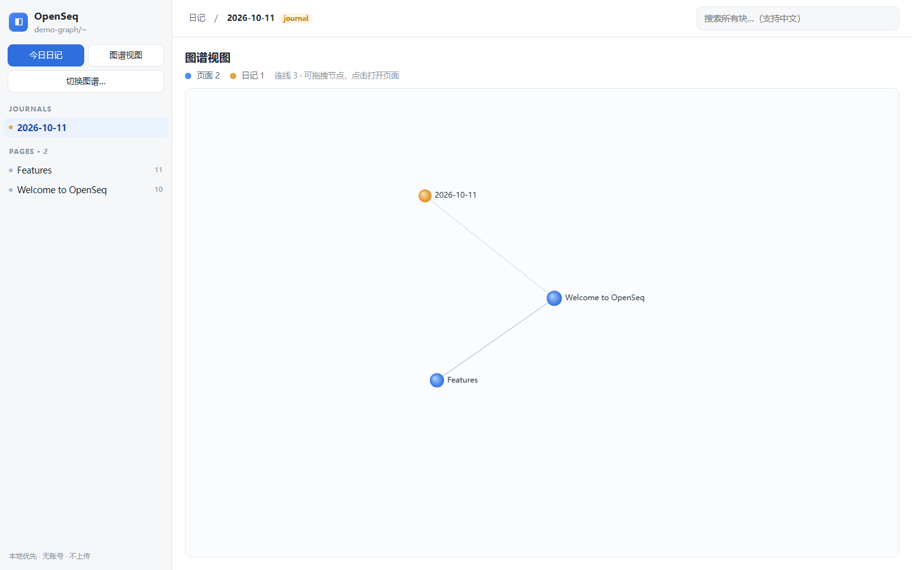

# OpenSeq

A **Logseq-compatible, local-first outliner** built with **Rust + TypeScript + Tauri 2**.

> This repository is a re-implementation of the *core* of
> [`logseq/logseq`](https://github.com/logseq/logseq) on a different stack.
> It is **not** a 1:1 port — see [Scope & honesty](#scope--honesty) below for
> exactly what is and is not implemented.

---

## Why this shape

Logseq's own core is ~26k commits of ClojureScript (React/Rum UI + a DataScript
in-memory Datalog database) wrapped in an Electron shell, plus a Capacitor
mobile app, a plugin runtime and encrypted sync. Rewriting that "functionally
identical" is a multi-person-year project, so this build makes a deliberate,
defensible cut:

| Layer | Logseq | OpenSeq |
| --- | --- | --- |
| UI | React via Rum (ClojureScript) | **React + TypeScript** |
| Data model | DataScript (Datalog) | plain Rust structs + `BTreeMap` |
| Storage | SQLite + files | **plain Markdown files only** |
| Shell | Electron | **Tauri 2 (Rust host, OS webview)** |
| Parser | `graph-parser` (Clojure) | **`crates/core` (Rust)** |

The result is the same *product shape* — a folder of Markdown files you own,
an outliner over it, links resolved into a graph — with a fraction of the
surface area.

---

## What works

**Rust core (`crates/core`)** — pure, testable, no Tauri dependency:

- Logseq-dialect **Markdown ⇄ block tree**, round-trip idempotent
  (`parse(serialize(p)) == p` is asserted in `tests/roundtrip.rs`).
- Nesting by indentation, multi-line blocks, fenced code blocks kept verbatim.
- Task markers `TODO / DOING / NOW / LATER / WAITING / DONE / CANCELED`,
  `[#A]` priorities, `key:: value` properties (page-level and block-level).
- Graph folder IO in Logseq's layout: `pages/`, `journals/`, `assets/`,
  including Logseq's file-name encoding (`a/b` → `a%2Fb.md`) and journal
  naming (`2026-10-11` → `journals/2026_10_11.md`).
- `[[page]]` / `#tag` / `((block-id))` extraction, **backlinks**,
  **linked references**, graph node/edge data.
- Full-text **search index with CJK support** (ASCII words + CJK unigrams and
  bigrams), rebuilt from the in-memory map so it can never drift from disk.
- Atomic writes (temp file + rename) so a crash cannot corrupt a page.
- **Dependency-light on purpose**: only `serde` / `serde_json` / `regex` /
  `thiserror`. No C code, no `raw-dylib`, no C toolchain — it builds and tests
  with a bare Rust toolchain. Block ids come from a local generator
  (`src/id.rs`) that still emits Logseq-compatible v4-shaped uuids.

**Tauri shell (`src-tauri`)** — a thin adapter:

- 18 `invoke` commands (open/create/reload graph, pages, save, delete, rename,
  search, backlinks, graph data, journal, block-id stamping, …).
- Recursive filesystem **watcher** → emits `graph-changed` to the UI.
- Remembers the last opened graph across restarts.

**Frontend (`src/`)** — React + TypeScript:

- Block-level **outliner**: `Enter` new block, `Tab` / `Shift+Tab` indent,
  `Backspace` on an empty block merges upward, `Alt+↑/↓` reorder, folding.
- Inline rendering of `[[links]]`, `#tags`, `((refs))`, `**bold**`, `` `code` ``.
- **Linked References** panel, **journals**, **search panel**, and a
  dependency-free **canvas force-directed graph view** (drag + click to open).
- Debounced autosave; every edit goes through the Rust serialiser.
- Runs in a plain browser via a small mock backend (`src/mock.ts`) so you can
  review the UI without a Rust toolchain.

---

## Scope & honesty

**Implemented (this deliverable):** the Markdown graph core, outliner editing,
links/backlinks, journals, search, graph view, file watching.

**Not implemented — and not claimed to be:**

- Plugin system / plugin API
- Whiteboards, flashcards / spaced repetition
- Datalog query DSL (`{{query …}}`), custom queries
- Encrypted sync, multiplayer, the mobile (iOS/Android) apps
- PDF annotation, Zotero integration, the marketplace
- `*.org` files (Markdown only — the parser will ignore `.org`)
- Every Logseq UI affordance (slash commands, block drag-and-drop, sidebars,
  multi-select, command palette …)

So: **"core feature parity", not "Logseq parity".** If you need the rest, it is
buildable on this foundation, but it is not here today.

---

## Status — what has actually been run

| Check | Result |
| --- | --- |
| `cargo test -p logseq-core` | **26 passed / 0 failed** (16 unit + 10 integration) |
| `cargo clippy -p logseq-core --all-targets -- -D warnings` | **clean** |
| `tsc --noEmit` | **0 errors** |
| `vite build` | **succeeds** (62 modules) |
| Frontend rendered in a real browser | **verified** — see screenshots below |
| `src-tauri` build (`cargo build -p openseq`) | **succeeds**, debug and `--release` (release is **4.4 MB**) |
| Desktop app launches | **verified** — the real Tauri window opens and renders the UI (see screenshots) |
| Installer bundles | **built** — `OpenSeq_0.1.0_x64-setup.exe` (NSIS, 1.55 MiB) and `OpenSeq_0.1.0_x64_en-US.msi` (2.22 MiB) |
| NSIS installer, end to end | **verified** — silently installed, the installed app launched, then uninstalled cleanly |

Not verified: no automated GUI test. The **MSI was inspected but never installed** —
its database is valid (`OpenSeq 0.1.0`, 2 files, `ALLUSERS=1`) and its payload is the
right size, but it installs per-machine and so needs elevation. The eight build
problems that had to be solved on the way are written up in `docs/DELIVERY.md`.

The test run caught a real bug (`[#A]` priority parsing was swallowing the block
text) that compiled fine but behaved wrong — which is the whole argument for the
Tauri-independent core. Details in `docs/DELIVERY.md`.

---

## Screenshots

**The real desktop app** — `target/release/openseq.exe` running natively on Windows,
no browser involved. Native title bar, the demo graph loaded from
`examples/demo-graph`, graph view rendering live:



**Frontend in a browser** (dev server against the mock backend, see `src/mock.ts`) —
useful for iterating on the UI without a Rust rebuild:

| Journal page | Graph view |
| --- | --- |
|  |  |

---

## Getting started

### Prerequisites

- Node.js ≥ 18
- Rust (stable) **and** a working linker for your target
  - Windows: MSVC build tools, or the GNU toolchain + MinGW-w64
  - macOS: Xcode command line tools
  - Linux: `webkit2gtk` / `libssl` per the Tauri docs

### Run

```bash
npm install
npm run dev            # browser-only demo (mock backend, no Rust needed)
npm run tauri dev      # the real desktop app in development mode
```

### Build

`tauri/build.rs` computes `dev = !custom_protocol`, so **only a build with the
`custom-protocol` feature embeds the frontend** and can run as a single file.
`tauri build` turns that on for you:

```bash
npm run tauri build    # → target/release/bundle/{nsis,msi}/…
                       #   plus target/release/openseq.exe (standalone)
```

Without the CLI the equivalent is
`cargo build -p openseq --release --features tauri/custom-protocol`.
A bare `cargo build -p openseq --release` is a **dev** build: it loads
`http://localhost:1420` at startup and shows a blank window if nothing serves it.

### Test the core

If you have a normal Rust install (MSVC on Windows, or any platform), plain
`cargo test` just works and you can skip this section.

This repository was developed with the toolchain kept **outside the repo but
inside the same workspace folder** — nothing machine-wide:

```
<workspace>/
├── .rust/                     rustc + cargo
├── .mingw/extract/mingw64/    binutils + gcc (as, ld, dlltool, windres, gcc)
└── logseq-tauri/              this repository
```

The helper script derives those paths from its own location:

```bash
source scripts/rust-env.sh          # bash / Git Bash
scripts\rust-env.cmd                # cmd / PowerShell
```

Override with `OPENSEQ_WORKSPACE` / `OPENSEQ_MINGW_ROOT` if your layout differs.
Then:

```bash
cd crates/core
cargo test                          # 26 tests
cargo clippy --all-targets -- -D warnings

cargo build -p openseq              # the desktop app
```

---

## Repository layout

```
logseq-tauri/
├── crates/core/            pure Rust domain core (no Tauri, fully unit-tested)
│   ├── src/model.rs        Block / Page / Property
│   ├── src/parser.rs       Markdown → block tree
│   ├── src/serializer.rs   block tree → Markdown
│   ├── src/store.rs        the on-disk graph
│   ├── src/refs.rs         [[page]] / #tag / ((id)) extraction
│   ├── src/search.rs       CJK-aware inverted index
│   ├── src/id.rs           v4-shaped block ids, no getrandom
│   └── tests/roundtrip.rs  end-to-end core tests
├── src-tauri/              Tauri shell
│   ├── src/lib.rs          app wiring
│   ├── src/commands.rs     the invoke surface
│   ├── src/state.rs        managed state + config
│   └── src/watcher.rs      graph file watching
├── src/                    React + TypeScript UI
│   ├── api.ts              the only place that talks to the backend
│   ├── store.ts            zustand state + debounced save
│   ├── lib/outline.ts      pure immutable block-tree operations
│   └── components/         Sidebar, Topbar, PageView, BlockRow, Backlinks, …
├── scripts/make_icons.py   generates the app icons (stdlib only)
├── scripts/rust-env.*      put the workspace-local Rust toolchain on PATH
├── docs/ARCHITECTURE.md    deeper design notes
├── docs/DELIVERY.md        what was verified / what was not
└── docs/TUTORIAL.md        Chinese walkthrough: read order + exercises
```

## License

MIT.
